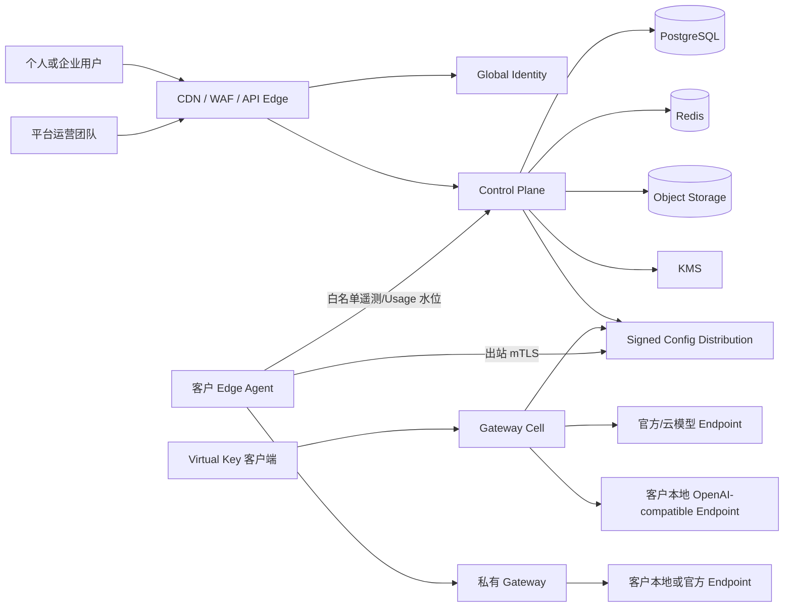
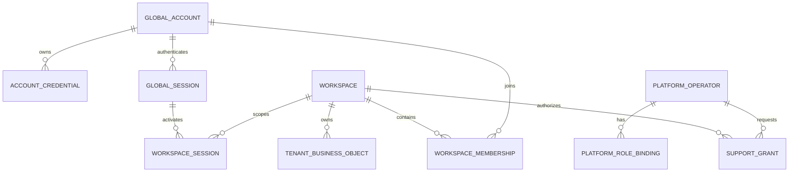

# MetaHub SaaS 目标架构基线

版本：`saas-architecture/v1`
冻结来源：PRD-090
状态：冻结；变更必须通过后续 PRD 或新的 ADR，不得静默修改。

## 1. 部署形态

| 形态 | 控制面 | Gateway 数据面 | Provider Secret | 管理方式 |
| --- | --- | --- | --- | --- |
| 个人 SaaS | MetaHub 云端 | 共享云 Cell | 租户云 KMS 信封加密 | 云端实时管理 |
| 企业 SaaS | MetaHub 云端 | 共享或专属云 Cell | 租户云 KMS 信封加密 | 云端实时管理 |
| 云管私有 Gateway | MetaHub 云端 | 客户网络 | 客户本地 KeyStore/KMS | 出站 mTLS、签名期望状态、允许字段遥测 |

标准产品形态只有上述三种。完全隔离环境是“云管私有 Gateway”的可选异步签名包能力，不是第四种实时管理形态；它没有云端实时连接、状态或撤销承诺。

不建设平台运营方统一托管客户 Provider Key 的共享 KeyPool。OpenRouter、硅基流动只属于竞品和迁移兼容目录，不能进入默认上游枚举。

## 2. 目标拓扑

Gateway 热路径不能同步依赖控制台、邮件、Webhook、支付、工单或平台运营服务。控制面不可用时，云 Gateway 使用有界 LKG；私有 Gateway 使用本地签名 LKG。授权撤销、预算耗尽、DLP、安全策略和错误签名必须失败关闭。

## 3. 身份与租户模型

### 3.1 不变量

1. `GlobalAccount` 是登录主体，不携带默认租户权限；邮箱/手机规范化唯一性属于平台身份域。
2. `Workspace(kind=organization)` 是业务隔离根；`workspace_id` 与现有 `tenant_id` 一一映射。个人空间不再属于产品或数据模型。
3. `WorkspaceMembership` 承载租户角色和状态。账号加入多个 Workspace 不复制密码凭据。
4. `GlobalSession` 只证明账号身份；`WorkspaceSession` 固定 `account_id + workspace_id + membership_revision`。切换 Workspace 必须轮换作用域，不能接受客户端提交 `tenant_id` 补权。
5. 平台账号通过 `PlatformOperator/PlatformRoleBinding` 授权。平台角色不自动生成 Membership，也不等于租户 `admin`。
6. 所有租户业务对象继续携带 `tenant_id`；新增接口可同时返回 `workspace_id`，但二者必须由服务端映射并一致。

### 3.2 Workspace与Tenant唯一绑定

目标模型固定新增 `WorkspaceTenantBinding(workspace_id UNIQUE, tenant_id UNIQUE, status, created_at)`，绑定创建后不可重绑。兼容期业务表仍以 `tenant_id` 为物理owner；服务端从已验证WorkspaceSession查绑定并重算tenant。请求同时出现二者时只能作为响应/内部断言，值不一致即失败关闭，客户端提交的tenant不能选择或扩大权限。

### 3.3 五类主体与凭据互不接受

| 主体 | issuer/audience | 签名密钥域 | 载体 | TTL/复核 | 可访问路由 |
| --- | --- | --- | --- | --- | --- |
| GlobalSession | `identity/global` | global-session key | Secure HttpOnly SameSite Cookie；写操作校验Origin+CSRF | <=12h；每请求复核Account状态 | `/identity/*`，不含tenant/role claim |
| WorkspaceSession | `identity/workspace` | workspace-session key | Secure HttpOnly SameSite Cookie；写操作校验Origin+CSRF | <=2h；每请求复核account+workspace+membership revision | 租户控制面 |
| PlatformSession | `platform/operator` | platform-session key | 独立平台域Cookie；强MFA | <=1h；每请求复核Operator/PlatformRole revision | `/platform/*` |
| SupportSession | `platform/support` | support-session key | 独立委托Cookie/Token | <=15min；每请求复核grant、审批主体、字段和撤销revision | 明确白名单租户诊断路由 |
| DeviceIdentity | `edge-control/deployment` | Edge CA + device proof | 双向TLS，不使用浏览器Cookie | 证书<=24h；每连接复核设备/证书/Deployment状态 | `/edge/*`自身Deployment |

五类issuer、audience和key domain不得复用或互相解释。当前带`tid/role`的HS256旧Token只允许N/N-1兼容期访问旧租户路由，不能被新identity/platform/edge路由接受。GlobalSession永不携带tenant或role；平台支持不能用PlatformSession直接调用租户业务路由，必须换取SupportSession。

浏览器Cookie固定使用`__Host-`前缀、`Secure`、`HttpOnly`、精确SameSite策略且不得设置`Domain`；写请求同时校验Origin和CSRF。兼容期若同一请求同时携带Bearer与Cookie，或多个Cookie可解释为不同主体，必须以固定错误失败，禁止任选其一。登录、注册、找回和邀请使用统一时序、防枚举响应、速率限制和风险判定，避免credential stuffing、账号探测和子域Cookie污染。

`SupportGrant`申请人不得审批自己的申请，两位审批者必须是不同主体，且至少一位为该Workspace客户授权者、一位为平台授权者。break-glass只能处理预先冻结的紧急范围，必须即时告警，并由客户与平台双方在事后时限内完成双复核；它不放宽字段白名单、Secret和正文禁令。

### 3.4 角色、页面与分配边界

页面可见性是后端权限的投影，不是授权来源。PlatformSession或WorkspaceSession建立后，后端按实时role/permission revision返回该主体的导航组和页面清单；页面只加载当前路由的数据。直接输入URL、恢复书签、调用API、并发降权或迟到响应仍逐请求复核主体、owner、permission和revision，拒绝时清理页面数据与草稿。

SaaS平台内置`platform_owner/platform_ops/platform_security/platform_billing/platform_support/platform_verification/platform_compliance/platform_privacy/release_manager/platform_provider_engineer/platform_channel/platform_customer_success/platform_growth`。平台人员只由Platform IAM中具备委派权限的人员添加，不能由企业管理员创建或授权。Provider工程角色只能维护官方Adapter、合同CI和内置错误目录，不能读取客户Provider Secret、请求正文或最终批准制品发布。

企业Workspace内置`owner/admin/developer/security_admin/finance_admin/legal_admin/auditor/viewer`，另有无浏览器登录能力的`service_account`。Workspace owner/admin可以邀请、停用和分配非Owner职能角色，但不能突破自己的delegation ceiling；授予或转移owner必须走独立二次验证。企业管理员的授权只在本Workspace生效，绝不能产生任何`platform_*`角色。

渠道管理、客户管理和增长分析只属于SaaS平台运营后台，对应`platform_channel/platform_customer_success/platform_growth`。平台主品牌与渠道白标、官方Provider Adapter/合同CI/内置错误目录、套餐目录/商业账/争议裁决、平台SRE配置也属于平台域。企业Workspace的导航、DOM、预取和API全部不提供这些平台管理模块；企业Owner也不能因最高租户权限进入平台客户目录、增长数据、Provider工程台或平台商业账写入口。

企业Gateway保留的是企业AI治理工作区，而不是平台运营后台：BYOK与本地Endpoint、Provider健康、模型目录/别名/路由/评测、Project/Application、Virtual Key、用量和内部FinOps、BYOK成本价、额度预算、策略/DLP/会话与输出安全、Webhook、调用与审计日志、Prompt/文件/批处理/MCP开发工具、成员/角色、数据生命周期和私有Deployment。`owner/admin/developer/security_admin/finance_admin/legal_admin/auditor/viewer`各自只收到职责页面；`service_account`没有浏览器导航。

当前tenant Console的64项导航处置以SaaS路线图Excel `11_现有导航处置`为机器可验收合同。目标企业信息架构默认折叠导航组且同一时刻只展开一组；角色任务首页给出可执行下一步；调试台、意图测试、Webhook死信和环境诊断只作为获授权高级入口。请求解释并入调用日志详情，文件安全并入文件详情/安全中心，Response Cache并入模型/路由高级配置，SDK示例/API文档/迁移指南/MCP归入开发者中心。`competitor-comparison`退出登录后产品UI，迁移兼容说明继续留在开发者文档。

## 4. 服务边界

| 边界 | 拥有的数据 | 可以做 | 不可以做 |
| --- | --- | --- | --- |
| Global Identity | GlobalAccount、AccountCredential、GlobalSession、验证意图 | 登录、注册、会话撤销 | 直接读取租户业务对象 |
| Workspace IAM | Workspace、Membership、WorkspaceSession、租户 RBAC | 选择/切换空间、实时授权 | 发行平台运营权限 |
| Platform IAM | Operator、PlatformRole、SupportGrant | 平台运维、JIT 支持审批 | 默认模拟租户管理员 |
| Control Plane | Provider 元数据、策略、预算、账本、配置事实 | 低频管理、签名快照 | 进入 Gateway 同步热路径 |
| Gateway Cell | Virtual Key、路由快照、请求/Usage 事实 | 代理、治理、追踪 | 信任前端 tenant 参数 |
| Edge Control | Deployment、DeviceIdentity、DesiredState、ACK | 云管私有 Gateway | 读取本地 Secret 或任意文件 |
| Edge Local | LocalSecret、LKG、本地运行账本 | 本地解封、调用、断网运行 | 上传 Key/Token/Prompt/Response |

### 4.1 旧跨租户指导的取代关系

本文明确取代《企业级AI_Gateway系统架构设计》D.1中“超级管理员权限+审计可跨租户查询”的旧建议。SaaS目标架构不存在通用superadmin跨租户业务读取：平台目录只能读取运营元数据；客户业务诊断必须以SupportGrant换取tenant-scoped SupportSession，再逐资源复核grant、字段、时限和撤销状态。历史文档保留审计价值，但不得作为PRD-090后的活动实现依据。

### 4.2 Owner传播矩阵

| 资源 | 强制owner组成 | 防护 |
| --- | --- | --- |
| SQL业务行 | tenant/workspace + object id | 复合唯一/FK；RLS仅作纵深防御 |
| Redis/cache/限流 | tenant/workspace + environment + resource | 规范前缀、TTL、generation；禁止全局裸key |
| 队列/lease/Scheduler | tenant/workspace + job + generation | claim后、副作用前重验owner/revision |
| Outbox/Webhook | tenant/workspace + source + delivery | 冻结安全payload；跨租户同形失败 |
| 对象/搜索/向量 | tenant/workspace前缀 + KMS context/index partition | 服务端生成路径；短时授权 |
| Metrics/trace/exemplar | 受控tenant/workspace摘要 | 标签白名单；禁止正文和秘密 |
| Edge遥测 | tenant/workspace + deployment + sequence | 设备签名、单调水位、去重 |
| 支持导出 | tenant/workspace + SupportGrant | 字段白名单、客户预览、到期删除 |

存在/不存在、同ID跨租户、分页、count、响应长度和主要时序必须同形，不能形成枚举侧信道。

## 5. 数据存储与驻留

- SQLite 只作为本地开发、测试和单机兼容基线；生产 SaaS 使用 PostgreSQL。
- Redis 只保存可重建缓存、短租约和限流状态，不能成为账务、授权或审计唯一事实源。
- 对象存储按 Workspace 前缀和 KMS key domain 隔离；下载使用短时受保护授权。
- 中国境内 Workspace 默认绑定境内 Region。故障切换、备份和支持访问不得静默越过驻留策略。
- Provider Key、Token 和本地 Secret 使用独立信封密钥域；Prompt/Response 默认不持久化，例外必须由后续数据治理 PRD 明确授权、保留和脱敏。

### 5.1 数据类别与位置矩阵

| 数据类别 | 云SaaS允许位置 | 私有Gateway允许位置 | 跨区/上传规则 |
| --- | --- | --- | --- |
| GlobalAccount PII/凭据 | 身份主Region；凭据独立KMS域 | 不复制凭据 | 跨Region Membership只存不可逆Account引用；复制需合规策略 |
| Workspace/Membership | Workspace Region控制面 | Agent只缓存必要成员revision | Region变更走迁移，禁止静默重绑 |
| 租户配置/策略 | Workspace Region；签名快照 | 本地LKG | 只向目标Cell/Deployment分发 |
| Provider Secret | 云执行平面的workspace DEK+KMS | 仅本地KeyStore/KMS | 私有Secret永不上云 |
| Prompt/Response/文件正文 | 默认不持久化 | 默认仅请求内存/客户策略存储 | 不进日志、遥测、支持证据 |
| Usage/账本/失败事实 | Workspace Region主库 | 本地账本+白名单同步 | tenant/deployment/sequence对账 |
| 审计/安全事件 | Workspace Region；不可变保留 | 本地安全审计，可上传摘要 | 不含正文/Secret |
| log/trace/metrics/cache/spool | 同Region受控基础设施 | 本地受限目录 | WAF/CDN/监控/临时文件同样受驻留约束 |
| 对象/搜索/向量索引 | Workspace前缀/分区 | 客户本地 | 禁止共享裸前缀/裸index |
| 备份/DR | 获准的同驻留Region | 客户指定介质 | 无合规目标时禁止跨区failover |
| 支持/验收证据 | 脱敏、限时、授权Region | 客户预览后导出 | 不得成为Secret/正文解密通道 |

Workspace Region不可静默修改；迁移必须有评估、双写/复制水位、冻结窗口、验证和回退。CDN/WAF、日志、监控、备份、临时文件和第三方处理方都在驻留范围内。

### 5.2 Secret密码学合同

云SaaS每个`workspace+secret+version`使用独立DEK并由KMS envelope；私有Secret只在本地KeyStore/KMS。AEAD AAD固定包含`execution_plane, workspace_id, deployment_id-or-cloud, secret_id, version, purpose`，跨owner/purpose/version移植必须解密失败。JWT、快照签名、Webhook HMAC、Provider Secret、备份和设备CA使用物理隔离的key domain。现有部署级环境Secret派生且无AAD的密文只属于legacy/local兼容，不满足SaaS生产合同。

## 6. 控制面到数据面合同

每份配置快照至少绑定：

- `workspace_id/tenant_id`
- `snapshot_id`、单调 `generation` 和 schema version
- 目标 `region/cell/deployment`
- `issued_at/expires_at`
- 内容摘要和签名 key version
- 不含 Secret 的 Provider 引用、路由、策略、预算和权限 revision

消费者只接受目标匹配、签名有效、schema 兼容且 generation 更高的快照。应用过程为预检、原子替换、ACK；失败保留 LKG，不允许部分生效。

### 6.1 Edge enrollment与证书授权

当前`X-Internal-Token`只允许legacy/local内部服务，明确禁止用于跨公网Edge。Edge enrollment意图以一次性hash、到期、workspace/deployment/device audience和CAS状态保存；100个并发兑换只能一个成功。设备在本地生成不可导出私钥并以CSR证明持有。独立Edge CA签发短期证书，SAN必须包含environment、workspace、deployment和device；服务端在TLS成功后仍复核证书状态、SAN owner、Deployment和单一active generation。连接只由Agent出站建立；轮换先PoP后签发，吊销在在线目标60秒内传播。

### 6.2 签名快照与持久LKG协议

- 规范编码固定RFC 8785 JSON（UTF-8）；拒绝duplicate key、non-finite number、未知字段/alg/kid。
- 签名算法首版固定Ed25519；snapshot signing root与Edge mTLS CA隔离。签名对象是完整RFC 8785 envelope：包含固定domain separator `metahub.desired-state.v1`、`protocol_version`、owner/audience、时间、generation、`alg`、`kid`和content，唯独排除`signature`字段；调用方不得自行拼接字段或字节。`content_sha256`只作冗余完整性校验，不替代对完整envelope的签名。
- 验证`kid` allowlist、签名、audience、schema、Region、时钟偏差（默认±5分钟）、过期和generation；拒绝降版、乱序、同generation异hash、未来时间和已撤销key。
- Agent把`accepted_generation+hash`高水位与LKG写入临时文件，flush+fsync文件、原子rename、fsync父目录后才ACK。高水位跨重启/备份恢复持久且不得回拨；损坏LKG时失败关闭需要该配置的调用。
- 签名根轮换使用current+next重叠窗和独立trust manifest。root/next更新必须由current root签名；完全离线环境中撤销清单同样不能实时生效，其暴露窗受trust-manifest TTL约束并必须在产品中显示。current root丢失、破坏或紧急换根只能使用离线recovery bundle，经两名不同授权主体批准、设备侧显式导入和审计后生效，不能只依赖云端数据库状态。设备审计对关键apply/rollback生成设备签名hash chain并可WORM导出。

### 6.3 离线撤销暴露窗

完全断网无法实时接收账号、设备、Key、策略或签名根撤销，产品必须显示该事实。安全/授权快照和trust manifest默认TTL 24小时，路由/价格等非授权配置默认TTL 7天；超过各自TTL，安全/授权类别失败关闭，非安全类别可按明确策略使用LKG并持续标记stale。高危客户可配置更短TTL或禁止离线调用。Workspace/Platform撤权`<2s`和在线Device证书吊销`<60s`都不适用于完全隔离模式。

## 7. 统一可靠性目标

| 能力 | 目标 |
| --- | --- |
| Control 普通读 | p95 < 300 ms（不含外部 IdP/支付/邮件） |
| 可交互页面 | p75 < 1.5 s，页面切换只加载当前页面依赖 |
| Gateway 平台开销 | p95 < 20 ms（不含模型上游） |
| Workspace/Platform动态撤权 | 在线云端 < 2 s |
| Device证书吊销 | 在线设备 < 60 s；离线暴露窗受trust-manifest TTL约束 |
| 普通配置传播 | 99% < 5 s |
| 云 Gateway | 目标可用性 99.95% |
| Control Plane | 目标可用性 99.9% |

## 8. 兼容与演进规则

- 采用 expand-migrate-contract，先新增全局表和映射，回填并双写，再切换读路径，最后移除旧登录租户字段。
- 旧租户用户默认只回填Workspace Membership，不获得PlatformOperator。生产平台Owner必须通过显式一次性bootstrap ceremony建立：无默认邮箱、强MFA、双人见证或离线恢复密钥、不可变审计，完成后立即关闭入口。
- 同一规范邮箱跨tenant存在不同密码hash、状态或展示资料时禁止自动择一合并。迁移进入冲突队列并要求重新验证邮箱和管理员确认；证明完成前保持隔离shadow account，disabled/revoked事实取更严格并集。
- 旧兼容读路径必须查询新Account/Membership、`tenant_data_states`和撤销tombstone的deny overlay；回滚只能切换读实现，不能撤销安全状态。
- PRD-001..089 的表、API 和完成证据不可改写；需要变化时由对应新 PRD 提供兼容期和回退开关。
- 公共 API、事件和数据迁移都必须版本化；N/N-1 兼容和回滚边界在实现前冻结。
- 本文不授权创建任何数据库迁移。首个身份迁移属于 PRD-091，并必须从 0082 之后继续编号。
